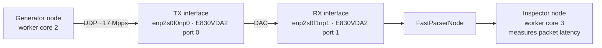
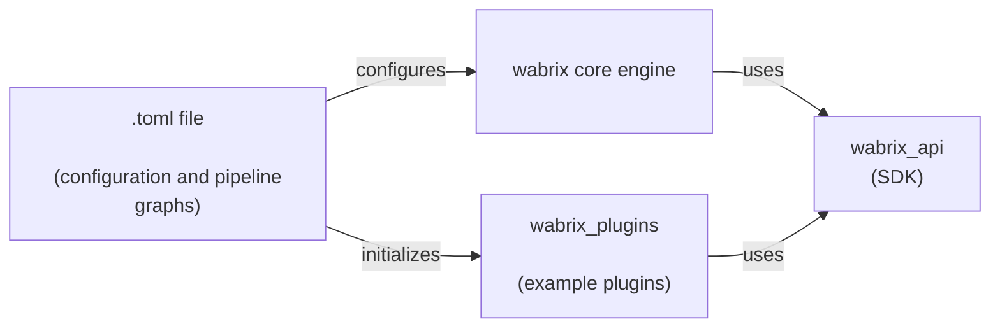

# Wabrix

**Build custom, stateful network services at line rate — using WebAssembly.**

Wabrix is a programmable network dataplane for developers who need application-specific packet processing at high packet rates.

Implement your own protocol parsers, traffic inspection, connection handling, and security policies in Rust or other WebAssembly-compatible languages. Deploy them as sandboxed Wasm modules without modifying the dataplane engine.

Wabrix combines Linux AF_XDP with direct packet access from WebAssembly, enabling high-performance processing without copying packet data into separate plugin buffers.

### Why Wabrix?

- **Programmable:** Implement custom network protocols and application-specific processing logic.
- **Stateful:** Maintain connection and application state across packets and live reloads.
- **High performance:** Up to 17 million inspected UDP packets per second per core in the demonstrated benchmark.
- **Sandboxed:** Execute custom processing logic in WebAssembly.
- **Hot-reloadable:** Replace stateful processing modules at runtime without restarting the dataplane.
- **Linux-native:** Built on AF_XDP and standard Linux networking drivers.
- **No Heavy Lifting**: No learning of DPDK, nor writing of low level AF-XDP socket or eBPF code. 


### Primary Use Cases

* **Bring-Your-Own-Protocol (BYOP) Parsing:** Drop-in support for proprietary, in-house, or legacy industrial protocols (IoT/Automotive/Manufacturing). Write a 50-line Rust parser, compile it to Wasm, and filter your custom UDP/TCP traffic at 25 Gbps without waiting for vendor firmware updates.
* **Line-Rate Volumetric Mitigation:** Dynamically deploy Wasm-based heuristics to silently drop 20+ Gbps of malicious DDoS traffic on standard COTS servers before it overwhelms sensitive control systems.


### Performance demonstrated

| Workload | Result |
|---|---:|
| UDP packet generation | 22 Mpps/core |
| UDP packet inspection | 17 Mpps/core |
| TCP connection setup and release | Over 1 million CPS/core |

*Benchmarks performed on an Intel Core i7-14700K. See the performance section for test configuration and limitations.*

### Who is Wabrix for?

Wabrix is intended for developers building network services with custom protocol logic, stateful processing requirements, and performance constraints that are difficult to satisfy with conventional solutions.
Examples include:
- Custom protocol inspection and security gateways.
- Stateful application-aware traffic processing.
- Specialized UDP/TCP services.
- Programmable network visibility and traffic filtering.

**Wabrix is open source and currently in alpha.**


## 🚀 Performance Metrics (Intel© Core™ i7-14700K)

* **TX Performance**: Generates **22 Mpps/core** time-stamped UDP packets using the WebAssembly generator engine (turbo mode)
* **RX Performance**: Evaluates **17 Mpps/core** time-stamped UDP packets using the WebAssembly inspector engine (turbo mode)
* **Stateful Inspection:** High-speed, wire-speed tracking of millions of concurrent connection states (L4/L7) with a minimal, deterministic memory footprint.
* **Efficiency:** Demonstrated setup and release of more than **1 million TCP connections/second per performance CPU core**.
* **Latency:** Deterministic, microsecond-level processing for time-sensitive industrial control loops.

Wabrix's TOML configuration lets deployments tune the tradeoff between
throughput and latency. This supports both low-latency applications and
workloads that require extreme throughput per core while avoiding long latency tails.

### 17 Mpps/core latency distribution of 500 million UDP packets

This example ([`gen_engine_1w.toml`](wabrix/examples/gen_engine_1w.toml)) is tuned for high throughput with batch sizes configured to 512 packets. 
Nevertheless, the 99% percentile limit is still at 100 microseconds and the 99.9% percentile at 150 microseconds.

The generator is
configured for 17 Mpps of UDP traffic on worker core 2. Packets leave one port
of the Intel E830VDA2 NIC, cross a DAC to its other port, packet headers get parsed by a native FastParserNode, and finally packets reach the
single-core inspector on worker core 3 for latency measurement. The run is using NAPI busy polling,
i.e., no extra cores for softirq interrupts.



The histogram below shows the latency distribution at 17 Mpps across a 500 million packet
sample. Each bucket spans 10 microseconds, and the logarithmic vertical axis
makes the exponentially decreasing low-frequency tail visible alongside the concentration in the
lower-latency buckets. **There is zero packet loss and no long tail.** (See also [Latency 16 Mpps.png](Latency%2016%20Mpps.png).)


## 🏗️ Architecture
The Wabrix project is split across three workspaces/crates: the `wabrix` core workspace, the `wabrix_api` crate, and the `wabrix_plugins` workspace. 
The `wabrix_plugins` workspace contains some example WASM plugins, like a packet generator and a simple tcp engine. 
The wabrix core and plugins workspaces depend both on the wabrix_api SDK crate. Plugins do not depend on the wabrix core.



Core configuration, including pipeline graphs, and the initialization of plugins is defined in `.toml` files. 

Wabrix works by bypassing the standard Linux networking stack using a modern, kernel-native approach:

1. **AF_XDP (Kernel Bypass):** Packets are moved directly from the Network Interface Card (NIC) memory (UMEM) to userspace.
2. **Wabrix vs. DPDK:** Both frameworks utilize dedicated core polling for maximum throughput. 
    However, Wabrix utilizes the Linux kernel's AF_XDP (eBPF) framework, achieving comparable line-rate performance using standard Linux drivers. 
    This preserves standard OS networking management, reduces deployment complexity, 
    and allows the kernel to retain control over power state transitions and hardware management.
3. **Zero-Copy Wasm:** The UMEM is mapped directly into the linear memory space of a WebAssembly runtime. Wasm plugins process the raw packet data in-place without `memcpy` operations.
4. **Programmable Pipeline:** Network pipelines are defined via TOML-based DAGs (Directed Acyclic Graphs), allowing for hot-reloading of networking modules without system reboots.

### Stateful Live Wasm policy updates

For a live `WasmEngine` update, deploy the replacement component at a new path,
change that node's `hot_args.wasm_file_path` in a target TOML file, then apply
the file with the running CLI's `apply <file.toml>` command. For example, update
`filter-v1.wasm` to `filter-v2.wasm` while leaving the node's routes and UMEM
unchanged.

Each worker compiles or loads and instantiates its replacement in the background.
It keeps processing with the current component until the replacement has passed
instantiation and `init-data`; then it switches between bursts and retires the
old runtime asynchronously. The AF_XDP sockets and pipeline stay running, and
packets already being processed finish on the old component. If staging fails,
that worker keeps the old component active and logs the error. Workers activate
independently, so a short rollout can have both component versions processing
traffic while the remaining workers finish staging.

The current Wasm interface does also migrate plugin-owned session state.
See [Wasm Component Hot Reloading](docs/wasm_hot_reload.md) for the full reload
lifecycle, configuration behavior, and operational limits.

## 📦 Getting Started

### Prerequisites
* **OS:** Linux. Kernel 6.1+ is recommended for AF_XDP support; kernel features and
  NIC drivers determine which XDP and zero-copy modes are available at runtime.
* **Rust:** The latest stable Rust toolchain, installed with `rustup`.
* **Native build tools:** A C compiler and linker, `clang`, LLVM, `pkg-config`,
  Git, and `m4`. The build compiles libbpf/libxdp and eBPF programs.
* **Development libraries:** libelf, zlib, and libpcap headers/libraries.

On Debian or Ubuntu, install the native build prerequisites with:

```bash
sudo apt update
sudo apt install build-essential clang llvm libelf-dev zlib1g-dev libpcap-dev pkg-config git m4
```

Install the `wasm32-wasip2` Rust target only when building Wasm guest programs
(for example, the `generator_engine` plugin):

```bash
rustup target add wasm32-wasip2
```

Loading XDP programs and configuring network interfaces at runtime requires
appropriate Linux capabilities; running as root is the simplest option for
development and integration testing.

### Quick Build
```bash
git clone https://github.com/ninegamma/wabrix
cd wabrix
cargo build -p wabrix --release --features wasm
```

### Runtime Diagnostics

The generator’s optional `runtime-diagnostics` feature records timer scheduling
data for rate-control investigations, including timer calls, credited cycles,
available-frame histograms, cap hits, timestamps, and the final accumulator.
The host-side feature also adds final timer counter summaries with pipeline and
worker identity. These diagnostics are disabled by default because they add
state and work to the timer path.

Enable host diagnostics when building Wabrix:

```bash
cargo build -p wabrix --release --features "wasm,runtime-diagnostics"
```

Build the generator plugin with its extended completion log separately:

```bash
cargo build -p generator_engine --release \
  --target wasm32-wasip2 --features runtime-diagnostics
```

*(Detailed installation instructions for XDP drivers and NIC-specific tuning are located in `/docs`.)*

## 📈 Monitoring with Prometheus and Grafana

Wabrix exposes its runtime telemetry as Prometheus metrics at
`http://localhost:9090/metrics`. The repository includes a Docker Compose
stack that collects these metrics with Prometheus and displays them in Grafana.

### Install and start the monitoring stack

Install Docker Engine with the Docker Compose plugin, then start the stack from
the monitoring directory:

```bash
cd monitoring
docker compose up -d
```

Start Wabrix separately so that its metrics endpoint is available on port
`9090`. Prometheus polls that endpoint every five seconds. The Compose
configuration maps the Prometheus web interface to port `9091` to avoid
conflicting with Wabrix's metrics server.

Open the following URLs in a browser:

* **Grafana:** <http://localhost:3000> (default login: `admin` / `admin`)
* **Prometheus:** <http://localhost:9091>
* **Wabrix metrics:** <http://localhost:9090/metrics>

Grafana is automatically configured with Prometheus as its data source and
loads the dashboards from `monitoring/grafana/dashboards/`. If Wabrix is not
running, Prometheus will show the target as down and Grafana will have no new
data to display.

To view the scrape status, open **Status → Targets** in Prometheus and check
the `wabrix_engine` target. Stop the stack with:

```bash
docker compose down
```

The Grafana data is stored in the named `grafana-data` volume, so dashboards
and Grafana settings persist when the containers are stopped.

## 🏢 The Ecosystem & Enterprise

Wabrix follows an **Open-Core** model:

* **Wabrix Core (Open Source):** The high-speed execution engine, TOML parser, and XDP socket management are freely available under the AGPLv3 license.

* **NineGamma Enterprise (In Development):** Wabrix is an evolving solo-project. 
My mid-term commercial roadmap focuses on advanced plugins for **Deep-Packet Inspection (especially for proprietary/custom protocols), 
specialized threat mitigation, and enterprise orchestration tools.**

**Looking for Design Partners**

I'm looking for 1–2 early adopters with demanding network-processing workloads to help shape Wabrix's development. If you have a real-world application requiring high-performance, programmable packet processing, I'd like to hear from you.

## 🤝 Contributing
Wabrix is currently in **Alpha**. I welcome contributions to the core engine, documentation, and performance tuning efforts. Please see [CONTRIBUTING.md](CONTRIBUTING.md) for details on our open-core philosophy and pull request process.

## ⚖️ Intellectual Property & Licensing
The Wabrix Core is licensed under **AGPLv3**.

The core architecture of Wabrix, specifically the zero-copy DMA mapping from AF_XDP (UMEM) directly into the WebAssembly linear memory space, is subject to a pending patent application.

In the spirit of open innovation, we grant a free patent license to any user strictly adhering to the terms of the AGPLv3 open-source license. For closed-source, commercial, or cloud-hosted integrations, a commercial Enterprise License is required.

*For Enterprise inquiries, Design Partnerships, or alternative licensing, [contact NineGamma](mailto:contact@ninegamma.com).*

"Wabrix" is a pending trademark of NineGamma. 

© 2026 NineGamma. All rights reserved.
