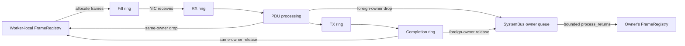

# Data Model and Architecture Summary

**Scope:** This document describes the data model, architectural roles, and frame lifecycle of the **Wabrix** Rust workspace — specifically the `wabrix_base` crate (core types: `FrameRegistry`, `SystemBus`, `UmemPartition`, `Pdu`, `RuntimeUmemConfig`) and the `wabrix_lib` crate (socket layer: `XSocket`, `XSocketRx`, `XSocketTx`, `XSocketRegistry`, system builder). The `wabrix_wasm` crate (plugin/WASM runtime) and the `wabrix` binary (CLI entry point) are not covered in detail here.

For the configuration, pipeline, control-plane, and telemetry overview, see [Wabrix Architecture Overview](../wabrix_lib/architecture_overview.md).

**Platform context:** Linux-only, kernel-bypass packet I/O via **AF_XDP**. The application maps shared memory (UMEM) directly with the NIC driver, bypassing the kernel network stack on the fast path. All types described below assume a Linux host with XDP-capable NICs.

## 1. High-Level Data Model: Multi-UMEM Static Partitioning Per Worker

The system implements a **Multi-UMEM Static Partitioning** model over multiple **Shared Global UMEM**. This separates physical memory regions from logical frame ownership by workers, enabling complex pipelines where workers bridge multiple memory domains (NUMA: Non-uniform memory architecture).

* **Global UMEM (UMEM Group):** A single, contiguous region of memory shared by multiple sockets (interfaces/queues) and worker threads.
    * It is logically divided into thousands of fixed-size frames (e.g., 2048 bytes each).
    * The OS sees one large memory map; the application sees discrete `FrameDesc` items.

* **Logical Partitioning:**
    * Each UMEM group is logically divided into N fixed-size partitions at initialization.
    * Each partition is a contiguous range of frames within that UMEM group.
    * Example: UMEM 0 (16k frames) is split into 4 partitions of 4k frames each.
    * Partitions define frame ownership within the shared UMEM region.

* **Static Ownership:** Although the memory is shared, each **worker thread** can be assigned multiple UMEM partitions with fixed frame ownership boundaries.
    * **Multi-Domain Ownership:** A single worker can own partitions in UMEM 0 and in UMEM 1.
    * Example: Worker 0 owns one partition of UMEM 0 and one partition of UMEM 1.
    * This prevents lock contention during allocation, as Worker 0 never competes with Worker 1 for a free frame.
    * **Key Design Principle:** Partitioning is per **worker**, not per core. Multiple workers can run on the same physical core but each owns distinct frame ranges.
    * Note: Although workers own frames of their assigned partitions, frames can still be sent between different workers.

* **Processing Foreign Frames and Returning Ownership:**
    * A worker can process *any* frame it receives from the NIC, even if it doesn't own it.
    * **Rule:** If a worker finishes with a frame it *does not own* (e.g., after a TX completion or a drop), it must "return" it to the original owner via the `SystemBus`.

## 2. Configuration Data Model

To enforce consistency across the shared memory region while allowing hardware flexibility, the configuration is split into two distinct structures.

### A. `RuntimeUmemConfig` (The Physical Layer)
Defines the physical properties of the memory region (runtime-resolved; created from TOML config during system initialization).
* **Key Fields:** `frame_size`, `frame_size_log2`, `head_room`, `frame_count`, `group_id`, `group_start_frame_idx`, `partitions`, `fq_size`, `cq_size`.
* **Constraint:** Every socket/manager in the same UMEM group **must** share an identical `Arc<RuntimeUmemConfig>` instance. This prevents memory corruption (e.g., one socket thinking frames are 2KB while another thinks they are 4KB).

### B. `XdpSocketConfig` (The Hardware Layer)
Defines the specific connection to the network hardware.
* **Key Fields:** `interface` (e.g., "eth0"), `queue_id`, `core_id`, `worker_id`, `rx_queue_size`, `tx_queue_size`, `zerocopy`, `xdp_mode`, `umem_config: Arc<RuntimeUmemConfig>`.
* **Relationship:** Holds an `Arc<RuntimeUmemConfig>` as `umem_config`, linking the hardware queue to the shared memory region it serves.
* **Note:** `core_id` specifies CPU affinity, while `worker_id` identifies the logical worker thread that owns the frame partition.

## 3. Role: `XSocket` (The Operator)

The `XSocket` acts as the **Hardware Interface**. It sits between the Linux Kernel's ring buffers and the application's logic.

* **Primary Responsibility:** Orchestrating the movement of frame addresses between userspace memory and the kernel rings.
* **Key Components:**
    * **The Socket:** Wrapper around the file descriptor (`Fd`).
    * **The Rings:** Handles to socket-bound `RxQueue` and `TxQueue`, plus `FillQueue` and `CompQueue` associated with the UMEM/interface/queue tuple.
    * **The Translator:** Resolves frame tokens to UMEM-local frame indices and converts them to UMEM-relative byte offsets for the rings (e.g., `500 * 2048 + 128`). These are not physical addresses.
* **Critical Actions:**
    * **`replenish_fill_queue`:** Pushes available frames from the Registry into the Fill Ring so the NIC has a place to write incoming packets.
    * **`drain_comp_queue`:** Pulls completed TX frames from the Completion Ring and returns them to the Registry (or sends them back to their owner).
    * **`stats`:** Queries the kernel for packet drops and error counters.

## 4. Role: `FrameRegistry` (The Accountant)

The `FrameRegistry` acts as the **Inventory Manager**. It is a container that manages the owned frames across multiple UMEM groups. It tracks which frames are currently free and available.

* **Primary Responsibility:** High-speed, lock-free management of free frames within a worker's partitions.
* **Ownership:** Each worker thread has exactly one `FrameRegistry`. Multiple sockets in the same worker access this shared registry via thread-local storage.
* **Top-level fields:**
    * **`worker_id`:** The owning worker's ID.
    * **`return_queue`:** A lock-free `Arc<ArrayQueue<u32>>` (bounded ring buffer) where *other workers* push bit-packed u32 commands for frames they are returning or sharing. The owning worker drains this queue in `process_returns()`.
    * **`bus`:** Reference to the `SystemBus`, used for routing returned frames and looking up partition ownership via `bus.partition_directory`.
    * **`registry_map`:** A `Vec<Option<PartitionData>>` indexed by `umem_group_id`. Each present entry is the per-UMEM allocation context.
* **`PartitionData` (per UMEM group, inside `registry_map`):**
    * **`free_stash`:** A `Vec<u32>` acting as a LIFO stack. This is the "hot cache" of frame tokens ready to be used immediately.
    * **`refcounts`:** A `Vec<u16>` tracking per-frame reference counts (for retain/release semantics).
    * **`refcount_start`:** The partition's UMEM-local start index; `local_idx - refcount_start` indexes the compact refcount array, matching the partition-relative token offset.
* **Canonical partition metadata** is stored in `SystemBus.partition_directory: Vec<Option<UmemPartition>>`, indexed by partition ID. `PartitionData.refcount_start` also stores the local start needed for compact refcount indexing. `SystemBus.frame_partition_maps` supports reverse lookup from UMEM-local indices.
* **Logic:**
    * When a socket needs frames (`alloc`), the Registry pops from `free_stash` in the relevant `PartitionData`.
    * `allocate_batch_into()` returns zero when its stash is empty; it does not drain returns automatically. RX calls `process_returns()` periodically (every 256 receive calls, or when total free frames fall below 8192). Each call processes at most 512 commands.
* **Thread Safety:** The registry itself is NOT wrapped in a Mutex. Instead, it's stored in thread-local storage, ensuring only one thread (the worker) ever accesses it.

## 5. The Frame Lifecycle Loop

1.  **Initialization:** Each worker's `FrameRegistry` starts with all its owned frames (e.g., Worker 0 owns 0-4095) in the `free_stash` of each `PartitionData`.
2.  **Fill (Replenish):** `XSocketRx` accesses the worker's registry via thread-local storage, pops frames from `free_stash`, and writes their UMEM-relative byte addresses (`u64`) to the **Fill Ring**.
3.  **Receive:** The NIC receives a packet, writes data to the frame in UMEM, and the driver moves the descriptor to the **RX Ring**.
4.  **Process:** The worker's application code polls the **RX Ring**, gets the descriptor, and processes the packet data.
5.  **Disposal:**
    * **Path A (TX):** The frame is put onto the **TX Ring**. Once sent, the kernel publishes its address to the **Completion Ring**. `XSocketTx` recovers the frame token and returns it directly to the local registry when owned by its worker, otherwise via `SystemBus` (also used as a fallback if the local registry is unavailable).
    * **Path B (Drop):** The PDU retains its original owner ID and frame token.
        * *If Owned by This Worker:* Returns directly to this worker's registry through thread-local storage when available, with `SystemBus` as fallback.
        * *If Owned by Different Worker:* Sent via `SystemBus` to the owning worker's `return_queue`.

## 6. The Three Layers of Addressing

1. **The Logical Layer (Your Application)**

        Unit: Frame token (u32)

        Encoding: 8-bit partition ID + 23-bit partition-relative offset (lower 31 bits)

        Purpose: Resource tracking. You use this to know which buffers are free vs. busy. This is what lives in the FrameRegistry's free_stash.

2. **The Transport Layer (The Rings)**

        Unit: UMEM Offset / Descriptor Address (u64)

        Formula: (UMEM-local frame index * Frame_Size) + Headroom

        Purpose: Communication with the Kernel. You write this value into the Fill Ring to tell the NIC "put data here". The Kernel writes this value into the RX Ring to tell you "data arrived here".

        Note: This is strictly an offset relative to the start of the UMEM, not a full pointer.

3. **The Virtual Memory Layer (Data Access)**

        Unit: Virtual Pointer (*mut u8)

        Formula: UMEM_Base_Address + UMEM_Offset

        Purpose: Reading/Writing packet bytes. You use this to cast EthHdr or Ipv4Hdr over the raw memory.


# AF_XDP Architecture: Entity Relationships

This chapter outlines the architectural relationships between Physical Hardware (Interfaces, Cores), Kernel Structures (Queues, Sockets), and User Space Memory Management (UMEM, Partitions).

## 1. Hierarchy Overview

The architecture is best understood as a hierarchy of constraints:

1.  **UMEM Group (Top Level):** Defines the shared memory region.
2.  **Network Interfaces:** Physical devices attached to the host.
3.  **Hardware Queues:** Parallel channels within an Interface.
4.  **XDP Sockets (xsk):** Each socket binds to one interface/queue pair; shared-UMEM sockets may share that pair.
5.  **Cores:** The processing units driving the Sockets.
6.  **Partitions:** Logical frame ranges within a UMEM group, assigned to workers for allocation and frame ownership.

---

## 2. Entity Definitions

### A. The UMEM Group (Shared Packet-Buffer Memory)
* **Role:** The massive, contiguous block of RAM where all packet data lives.
* **Scope:** Shared across multiple sockets, interfaces, and cores.
* **Physicality:** It is a single `mmap`'d region from the OS perspective.
* **Addressing:** AF_XDP descriptors carry UMEM-relative byte offsets; application data access uses the mapped virtual base plus an offset.
* **Key Constraint:** All sockets in a "UMEM Group" must agree on `Frame Size` and `Headroom`.

### B. The Interface (NIC)
* **Role:** The physical hardware (e.g., `eth0`, `eth1`).
* **Queues:** Modern NICs support **RSS (Receive Side Scaling)**, splitting traffic into multiple Hardware Queues (e.g., Queue 0, Queue 1, Queue 2).
* **Isolation:** In "Program Relocation" mode, each Interface runs its own isolated BPF program instance.

### C. The XDP Socket (xsk)
* **Relation:** Each socket binds to one hardware queue on one interface. Multiple shared-UMEM sockets can bind to the same interface/queue pair.
* **Role:** The "Doorbell" to the kernel.
    * **RX Ring:** Kernel tells User: "Packet arrived at Address X".
    * **TX Ring:** User tells Kernel: "Send packet at Address Y".
    * **Fill Ring:** User gives Kernel: "Here are empty frames (Addresses) you can use".
    * **Comp Ring:** Kernel gives User: "I finished sending these frames".
* **Sharing Rule:** Fill/Completion rings are associated with a UMEM + interface + queue tuple. Shared-UMEM sockets using the same tuple share those rings; different tuples have separate rings.

### D. The Core (CPU)
* **Relation:** **1 Worker Thread ↔ 1 Core** (Ideal Performance, via CPU affinity).
* **Role:** Physical CPU core where a worker thread executes.
* **Affinity:** CPU affinity limits where a worker runs. One worker per core is preferred for performance, but several workers can share a core; affinity does not eliminate all context switches.
* **Note:** The relationship is **Worker → Core**, not **Socket → Core**. Multiple sockets can run on the same worker thread.

### E. The UMEM Partition (Logical)
* **Relation:** **1 Partition ↔ 1 Worker Thread**.
* **Role:** A contiguous range of frames within a UMEM group assigned to a specific worker thread.
* **Example:** A UMEM group has 10,000 frames.
    * Worker 0 owns Partition [0 - 4,999].
    * Worker 1 owns Partition [5,000 - 9,999].
* **Purpose:** **Lock-Free Allocation.** Worker 0 can allocate from its partition without locking against Worker 1.
* **Key Point:** Partitioning is per **worker thread**, not per physical core. Two workers pinned to different cores will have separate partitions, even if running the same code.

---

## 3. The Relationship Matrix

| Component A | Component B | Relationship | Description                                                                                               |
| :--- | :--- |:-------------|:----------------------------------------------------------------------------------------------------------|
| **Interface** | **Queues** | 1 : N        | One NIC has multiple queues (RSS).                                                                        |
| **Queue** | **XDP Socket** | 1 : N        | Each socket binds to one interface/queue pair; shared-UMEM sockets can share that pair.                                     |
| **Worker Thread** | **XDP Sockets** | 1 : N        | One worker thread can manage multiple sockets for efficient resource utilization.                         |
| **Worker Thread** | **Core** | N : 1        | Each worker has configured CPU affinity; one worker per core is preferred, but cores may be shared.                                              |
| **Worker Thread** | **Partition** | 1 : M        | Each worker may own partitions from multiple UMEM groups for lock-free allocation.                        |
| **UMEM Group** | **Interfaces** | 1 : N        | One memory region can serve `eth0` and `eth1` simultaneously, allowing Zero-Copy forwarding between them. |
| **UMEM Group** | **Partitions** | 1 : N        | The UMEM region is logically divided into N partitions.                                                   |
| **Partition** | **Frames** | 1 : M        | A partition strictly owns a specific range of UMEM-local frame indices.                                              |

---

## 4. Visualizing the Data Flow

### Scenario: Zero-Copy Forwarding (Router)

**Setup:**
* **UMEM Group:** Shared Memory (Indices 0–8191).
* **Worker 0:** Owns Partition A (Indices 0–4095). Runs on Core 0. Manages `eth0` / Queue 0.
* **Worker 1:** Owns Partition B (Indices 4096–8191). Runs on Core 1. Manages `eth1` / Queue 0.

**The Flow:**
1.  **Alloc:** Worker 0's registry (accessed via thread-local storage) pops `Frame #100` from its stash (Partition A).
2.  **Fill:** Worker 0's `XSocketRx` puts the UMEM byte offset of `Frame #100` into the `eth0` Fill Ring.
3.  **RX:** Packet arrives on `eth0`. Driver puts data in `Frame #100`.
4.  **Process:** Worker 0 reads `Frame #100`. Decides to forward to `eth1`.
5.  **Forward:** A cross-worker pipeline handoff must explicitly transfer the PDU to Worker 1, preserving its frame token and original owner (Worker 0). SystemBus carries frame lifecycle commands, not packet batches. Same-worker forwarding needs no cross-worker handoff.
6.  **TX:** Worker 1's `XSocketTx` puts `Frame #100` onto `eth1` TX Ring. **(Zero Copy: Data never moved)**.
7.  **Completion:** `eth1` finishes sending. the address of `Frame #100` appears in the `eth1` Completion Ring.
8.  **Return:** Worker 1's `XSocketTx` drains Completion Ring. Sees `Frame #100`.
    * *Check:* "Does Worker 1 own #100?" -> No (Worker 1's Partition B starts at 4096).
    * *Action:* Worker 1 sends `Frame #100` back to Worker 0 via SystemBus.

---

## 5. Summary of Your Rust Structs

* **`RuntimeUmemConfig`**: Defines the physical properties of a UMEM group ("the Warehouse"). Created at startup from TOML config; shared via `Arc` among all sockets in the group.
* **`XSocket`**: Represents a socket bound to a hardware queue. It is split into RX and TX halves for independent pipeline access.
* **`XSocketRx`**: RX-only component of a split socket. Accesses the worker's frame registry via thread-local storage.
* **`XSocketTx`**: TX-only component of a split socket. Returns same-owner frames directly through the TLS registry when available and routes other returns through SystemBus. It can allocate replacement frames for cross-UMEM transmission.
* **`FrameRegistry`**: The worker's combined frame inventory. Holds `worker_id`, a `return_queue` (`Arc<ArrayQueue<u32>>`), a `bus` reference, and `registry_map: Vec<Option<PartitionData>>` indexed by UMEM group. Stored in thread-local storage — only the owning worker thread accesses it directly.
* **`PartitionData`** *(inside `FrameRegistry.registry_map`)*: Per-UMEM allocation context for one worker. Holds `free_stash: Vec<u32>` (LIFO stack of available frame tokens), `refcounts: Vec<u16>` (per-frame reference tracking), and `refcount_start` (the UMEM-local start for compact indexing).
* **`SystemBus`**: The mechanism to satisfy the **Ownership Rule** (returning frames between workers). Holds one `Arc<ArrayQueue<u32>>` per worker (`bus_senders`) and a partition-ID-indexed directory of canonical `UmemPartition` values for ownership lookup. Commands are bit-packed into a single `u32`: bit 31 = command (0=Release, 1=Retain), bits 30-23 = partition ID, and bits 22-0 = partition-relative offset.
* **`UmemPartition`**: Contains `partition_id`, `worker_id`, `umem_group_id`, `start_idx`, `end_idx` (absolute frame range), plus `local_start` and `local_end` (UMEM-relative range) to define frame ownership boundaries and resolve partition-token offsets.

---

## 6. Split Socket Architecture: Independent RX and TX Binding

### Problem Statement
An AF_XDP socket has both RX and TX rings. In a pipeline architecture, we need the flexibility to:
* Bind different nodes to the same socket's RX and TX rings independently
* Support bidirectional packet forwarding without queue conflicts
* Avoid mutex contention on the critical data path

**Example Use Case:** Bidirectional bridge between two interfaces
```
Pipeline 1: Interface A (RX) → Interface B (TX)
Pipeline 2: Interface B (RX) → Interface A (TX)
```
Both pipelines need access to the same physical queues but for different operations (RX vs TX).

### Solution: Socket Splitting

When an `XSocket` is added to the `XSocketRegistry`, it is immediately split into two independent components:

#### A. XSocketRx (The Receiver)
**Owns:**
* RX queue (exclusive access)
* Fill queue handle (shared via `Arc<Mutex<_>>`; shared-ring users synchronize access)
* UMEM reference (for data access)
* Partition info (to identify owned frames)

**Accesses via Thread-Local Storage:**
* Worker's `FrameRegistry` (for frame allocation and return processing)

**Responsibilities:**
* Poll RX ring for incoming packets
* Create PDUs from received frames
* Process frame returns from TX via SystemBus (by calling registry's `process_returns()`)
* Replenish fill queue with available frames from the worker's registry

**Key Method:** `receive_into_batch(&mut self, batch, max_count)` polls RX descriptors, resolves their frame tokens and original owners, and appends PDUs to the batch. Return processing is periodic or triggered by low free-frame availability, rather than performed on every call.

#### B. XSocketTx (The Transmitter)
**Owns:**
* TX queue (exclusive access)
* Completion queue handle (shared via `Arc<Mutex<_>>`; shared-ring users synchronize access)
* UMEM reference (for data access)
* Partition info (to determine frame ownership)
* SystemBus reference (for returning frames)

**Registry Access:**
The registry remains owned by the worker, rather than by either socket half. TX accesses it through thread-local storage for same-owner releases and for replacement-frame allocation when a packet originates in another UMEM group. Cross-UMEM transmission copies packet bytes into a frame belonging to the target UMEM; shared-UMEM forwarding can reuse the descriptor.

**Responsibilities:**
* Transmit PDUs from a batch to the TX ring
* Drain the Completion ring and recover frame tokens from completed addresses
* Return same-owner frames directly through the local registry when available
* Route foreign-owner returns (and local fallback returns) through the owner's SystemBus queue

### Frame Flow in Split Socket Model



Local returns also use SystemBus as a fallback if the local registry is unavailable.

### Key Properties

1. **Synchronization:**
   - RX and TX halves bind independently to pipeline nodes
   - Socket ring handles use mutex wrappers, including RX/TX and shared Fill/Completion rings
   - The worker's `FrameRegistry` is accessed through thread-local storage without a registry mutex
   - Both RX and TX may access the local registry

2. **Frame Circulation:**
   - Frames flow from allocation through RX, packet processing, TX, and completion, or return on drop
   - Same-owner releases normally use the local registry; foreign-owner releases use bounded lock-free queues
   - `process_returns()` drains at most 512 packed commands per call
   - Frame availability depends on timely completion, release, and return processing. A full return queue currently logs a leaked frame; the design does not guarantee freedom from starvation

3. **Independent Node Binding:**
   - BatchRxNode can take RX component
   - BatchTxNode can take TX component
   - Same socket serves both nodes independently
   - Enables bidirectional pipelines on same queues

4. **SystemBus Coordination:**
   - One `Arc<ArrayQueue<u32>>` per worker; both senders and the registry share the same Arc
   - Works transparently for same-worker and cross-worker scenarios
   - Packed u32 format: bit 31 = command, bits 30-23 = partition ID, bits 22-0 = partition-relative offset
   - Routes based on worker_id, not core_id

### Registry Behavior

`XSocketRegistry` stores independently takeable RX and TX halves keyed by interface and queue ID. Taking a half consumes that binding while leaving the other half available to another node.

### Example: Bidirectional Bridge Configuration

The following is a schematic configuration excerpt, with omitted fields and routes; it is not a complete TOML configuration.

```text
[wabrix]
# Both interfaces use same queue IDs
xsk = [
    { iface = "eth0", queues = [0, 1], umem = 0, ... },
    { iface = "eth1", queues = [0, 1], umem = 0, ... },
]

[[pipelines]]
name = "forward"
workers = [0, 1]
    [[pipelines.nodes]]
    id = "rx_eth0"
    type = "BatchRxNode"
    args = { interface = "eth0", queues = [0, 1] }  # Takes RX component

    [[pipelines.nodes]]
    id = "tx_eth1"
    type = "BatchTxNode"
    args = { interface = "eth1", queues = [0, 1] }  # Takes TX component

[[pipelines]]
name = "reverse"
workers = [0, 1]
    [[pipelines.nodes]]
    id = "rx_eth1"
    type = "BatchRxNode"
    args = { interface = "eth1", queues = [0, 1] }  # Takes RX component

    [[pipelines.nodes]]
    id = "tx_eth0"
    type = "BatchTxNode"
    args = { interface = "eth0", queues = [0, 1] }  # Takes TX component
```

Both pipelines can coexist because they access different rings of the same sockets.

# Understanding UMEM-local indices and frame tokens

This chapter distinguishes UMEM-local frame indices, absolute layout positions, and frame tokens. `group_start_frame_idx` is used to calculate absolute layout positions while partitions are built. A frame token is the identifier used by PDUs and SystemBus.

## 1. The Problem: Duplicate Indices (Address Collision)

In the raw hardware view, every separate UMEM region starts counting its frames at **0**.

* **Group 0 (eth0 Memory):** Contains UMEM-local frames `0, 1, 2 ... 4095`.
* **Group 1 (eth1 Memory):** Contains UMEM-local frames `0, 1, 2 ... 4095`.

The same local index can refer to a frame in either UMEM group. SystemBus messages therefore carry a frame token, which identifies a partition and an offset within that partition; the partition directory resolves it to the owning worker and UMEM group.

## 2. Absolute layout positions and frame tokens

During partition construction, the system can assign each UMEM group a range in one absolute frame layout. The `group_start_frame_idx` is the base offset for converting between that layout position and a UMEM-local index. Runtime frame ownership uses frame tokens instead of these absolute positions.

For example, Group 1 may have absolute layout positions `4096..8192`, while its UMEM-local frame indices remain `0..4096`. A frame token for a frame in that group carries the partition ID and partition-relative offset, not the absolute layout position.

## 3. Address translation

The socket translates between frame tokens and UMEM-local addresses at the kernel boundary.

### Direction A: Allocation / Fill → Kernel
Resolve an allocated frame token through the partition directory to obtain its UMEM group and UMEM-local frame index. The initial descriptor address is:

```text
address = (u64(local_idx) << frame_size_log2) + headroom
```

Normal TX uses the PDU's existing descriptor address, which may reflect packet-offset adjustments. It does not rebuild that address from the frame token for each send. Cross-UMEM TX allocates a replacement frame in the destination group and copies the packet.

### Direction B: Kernel → Application / Registry
For aligned frames, derive the UMEM-local index from the descriptor address, resolve the corresponding partition, and preserve the resolved original owner when creating a PDU. Completion processing performs the same reverse lookup to recover the token for release.

```text
local_idx = u32(descriptor_address >> frame_size_log2)
resolved = bus.resolve_local_frame_idx(group_id, local_idx)
frame_token = resolved.frame_token
owner_id = resolved.worker_id
```

The receiving worker is not necessarily the frame owner. Headroom and packet offsets must remain within the frame for this index calculation.

## 4. Detailed Address Calculation: UMEM, XSK, and Address Spaces

* **Frame token:** A system-wide lifecycle identifier encoding an 8-bit partition ID and a 23-bit partition-relative offset. Bit 31 is reserved for the SystemBus command (release or retain).
* **UMEM-local frame index:** An index from zero to `frame_count - 1` within one UMEM group. Resolving a token gives `partition.local_start + partition_offset`.
* **Descriptor address:** A `u64` byte offset within the UMEM group, used by AF_XDP rings. RX/TX carry `FrameDesc` records; Fill/Completion carry addresses.
* **Virtual data pointer:** The mapped UMEM base plus the packet's descriptor offset.

### Example

For two UMEM groups of 4096 frames each, with frame size 2048 bytes and headroom 256, Group 1 may have `group_start_frame_idx = 4096`. Its local index 4 has absolute layout position 4100, but initial descriptor address `(4 << 11) + 256 = 8448`. The token identifies the partition containing local index 4 and its offset within that partition; it does not encode 4100.

### Why Partitioning Does Not Change `group_start_frame_idx`

**Important:** When a UMEM group is partitioned among multiple workers, the `group_start_frame_idx` remains constant for ALL workers sharing that UMEM group.

For example, Group 1 starts at absolute layout position 4096, and its second partition starts at 6144. Absolute position 6148 has UMEM-local index `6148 - 4096 = 2052` and partition-relative offset `6148 - 6144 = 4`. Using the partition start as the group base would incorrectly use local index 4 for the descriptor address.

The canonical partition directory stores both absolute and UMEM-local ranges. `PartitionData.refcount_start` stores the partition's UMEM-local start (2048 in this example) for refcount indexing; it does not replace the group's base.

The partition boundaries control frame **ownership** (which worker can allocate which frames), but do not affect **addressing** (how frames map to UMEM memory).

### Summary Table

| Address Type | Scope | Used By | Range Example (Group 1) | Purpose |
|-------------|-------|---------|-------------------------|---------|
| **Frame token** | System-wide | Application, SystemBus, FrameRegistry | Partition ID + offset | Unique frame identification |
| **Local Index** | UMEM-group | Internal calculations | 0 - 4095 | Index into UMEM frame array |
| **Descriptor Address** | XSK/Kernel | AF_XDP rings | 256 - 8,386,816 (initial offsets with 256-byte headroom) | Byte offset in UMEM region |

**Conversion Rules:**
- `frame_token = encode_frame_token(partition_id, partition_offset)`
- `local_idx = resolve_frame_token(frame_token, partition_directory).local_idx`
- `frame_token = resolve_local_frame_idx(umem_group_id, local_idx).frame_token`
- `descriptor_addr = (local_idx << frame_size_log2) + headroom`
- `local_idx = descriptor_addr >> frame_size_log2` (headroom is within frame bounds)
